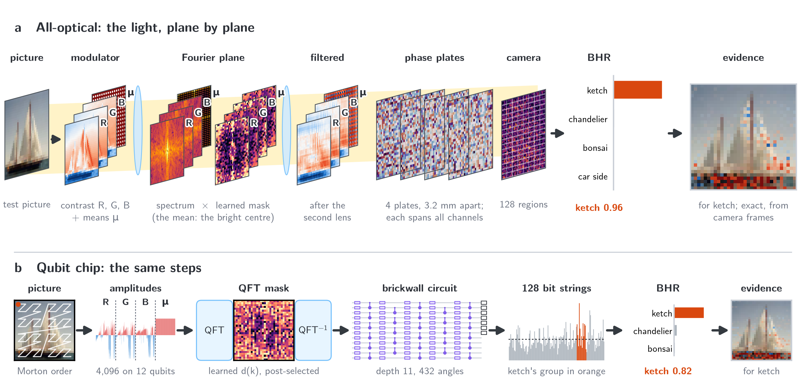

# Seeing Why: Exact Evidence Maps for Quantum and Optical Image Classifiers

Interactive companion to the paper by Teerawat Tongloy (KMITL) and Rangsan Jomtarak (Suan Dusit University).

| | |
|---|---|
| Try it: pick a picture and see why the model decides (CPU, no install) | [](https://colab.research.google.com/github/stein-research/seeing-why/blob/main/demo/demo.ipynb) |
| Train a model in the simulator (GPU) | [](https://colab.research.google.com/github/stein-research/seeing-why/blob/main/demo/train.ipynb) |
| Paper | arXiv link to follow |



*(a) All-optical: the picture on a modulator (three contrast planes and a plane of the colour means), a 4f system
with a learned mask in its Fourier plane, four phase plates and a camera of 128 regions, read with the Born headroom
readout (BHR); the evidence for "ketch", which a bench can measure from camera frames, lies on the dark hull. (b) Qubit chip: the same steps with a quantum
Fourier transform, a brickwall circuit and 128 measured bit strings.*

The classifiers have no trained classical network before or after the quantum or optical part: a 32 x 32 colour
picture is amplitude-encoded, filtered by a learned mask in the Fourier plane, and passed through four phase plates
(light) or a brickwall circuit on twelve qubits; the measured probabilities are read with the Born headroom readout.
Because the model is linear in the input amplitudes up to the measurement, the evidence of every pixel has a closed
form and adds up to each class's probability above its share, and it can be measured on the hardware itself.

## How it works

The measurement has $N$ outcomes, split into one group $S_g$ per class; class $g$ collects the probability
$P_g = \sum_{b \in S_g} P_b$. With no information about the input, a circuit gives each class only its share
$b_g = |S_g|/N$. The **Born headroom** is how far the class rises above that share, in units of the room above it:

```math
u_g = \frac{P_g - b_g}{1 - b_g} \in \Big[-\frac{b_g}{1-b_g},\; 1\Big]
```

Every class has the same ceiling of 1, whatever the size of its group. The **readout** turns headrooms into class
probabilities with no trained parameter; one chosen headroom $\varphi$ fixes the temperature:

```math
\hat p = \mathrm{softmax}\left(\kappa\, \mathrm{LeakyReLU}(u)\right), \qquad
\kappa = \frac{\ln\big[(1-\varepsilon)(G-1)/\varepsilon\big]}{\varphi}
```

($G$ classes, $\varepsilon = 0.01$, $\varphi = 0.0556$: the true class is called with probability $1-\varepsilon$ once
it holds 1.5 times its share.) Because the picture $a$ enters linearly up to the measurement ($A$: the mask and the
circuit or plates), the **evidence** of every encoded amplitude $x$ (one pixel of one plane) has a closed form, shown as a **Born evidence map (BEM)**, and it adds up exactly:

```math
e_g(x) = \frac{a(x)\,\mathrm{Re}\big[M_g\, a\big](x)}{Z}, \qquad
M_g = A^\dagger (\Pi_g - b_g) A, \qquad
\sum_x e_g(x) = P_g - b_g
```

($Z$: the light that reaches the measurement.) Red pixels in the maps push a class above its share, blue ones pull it
below. The same quantity is measured on the hardware: on a qubit chip from three class probabilities per block
(polarization identity), on a lens bench from camera intensities alone.

## Contents

| | |
|---|---|
| [`demo/`](demo/) | the two notebooks and their helpers ([`seeing_why.py`](demo/seeing_why.py), [`ui.py`](demo/ui.py)) |
| [`src/`](src/) | the simulator, the optics, the readout, the evidence maps, the trainer, and the scripts that ran the IBM jobs |
| [`results/`](results/) | the four trained models of the demo (weights inside each JSON) and the IBM test-set and map results |
| [`data/`](data/) | Caltech-10 (32 x 32, from Caltech-101, CC BY 4.0); see [`data/README.md`](data/README.md) |
| [`ibm_jobs/`](ibm_jobs/) | the record of every job run on IBM's ibm_kingston: job id, times, calibration, qubits, circuits, raw counts (account details removed) |

## Use of AI tools

An AI assistant (Claude, Anthropic) was used throughout this work: to write and run simulation and analysis code, to
prepare and check the hardware jobs, to draw the figures, and to draft and revise the text. All research directions,
decisions and claims are the authors'.

## Licence and citation

Code: MIT ([`LICENSE`](LICENSE)). Caltech-10 is derived from Caltech-101 (CC BY 4.0, see [`data/README.md`](data/README.md)).
Please cite the paper ([`CITATION.cff`](CITATION.cff)).
